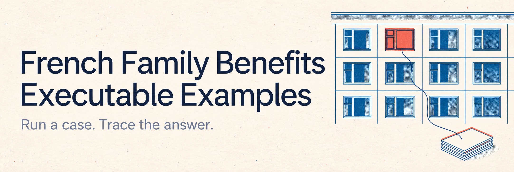
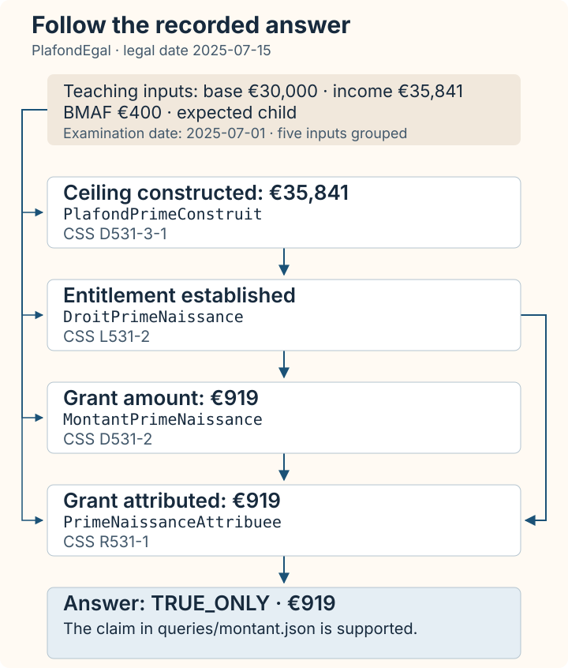

[](https://books.arxo.io/law-as-code-france/)

# French Family Benefits — Executable Examples

[](#browse-the-cases)
[](#verify-the-recorded-answer)
[](#quick-start)
[](LICENSE)

Explore ten fictional family files: run the rules, compare answers, and trace
their reasoning to published French legal sources.

**[Run your first example](#quick-start)** ·
**[Browse the cases](#browse-the-cases)** ·
**[Read the book](https://books.arxo.io/)**

> **First of all, a demonstration.** These case packages show what modelling legislation with Arxo can
> do: fictional families' files answered by executable French family-benefit canons, with the source of
> every answer. They do not claim legal accuracy or completeness, they are not an implementation by or
> for the Cnaf or any French authority, and their answers are not legal advice. For a real file, rely
> on the official texts and the competent bodies.

These examples accompany *Law as Code in Practice: French Family Benefits*
(Law as Code by Country · Volume 1). You can start without reading the book.
For a browser introduction, open [French Benefits Lab](https://french-benefits.law.arxo.io/)
— no installation. The lab has its own recorded evidence release; its cases
and version are separate from this reproduction kit.

## Your first answer

**Does the model establish a birth grant when income is exactly at the ceiling?**
The Moreau example compares equality, an excess of one cent, and missing income.
Here is a readable summary of its [saved equality answer](prime-naissance-moreau/runs/plafond-egal/result.json),
not literal terminal output:

```text
Case:          PlafondEgal
Legal date:    15 July 2025
Claim tested:  Birth grant of €919
Answer:        Established — TRUE_ONLY
```

**These are teaching parameters:** a €400 family-benefit calculation base
(BMAF) and a €30,000 base ceiling. They are not the published annual amounts
for this family. The [manual calculation](prime-naissance-moreau/sources/WITNESS.md)
shows how the model obtains the €35,841 ceiling and €919 grant.

### Change one input, compare the answers

| Moreau file | Annual income | Entitlement claim | What changes |
|---|---|---|---|
| `PlafondEgal` | €35,841 | `TRUE_ONLY`; the grant claim of €919 is also supported | Equality satisfies the ceiling condition. |
| `PlafondDepasse` | €35,841.01 | `NEITHER` | An excess of one cent prevents entitlement from being derived. |
| `RessourcesAbsentes` | Not supplied | `NEITHER` | The model cannot establish the income comparison. |

All three are completed evaluations (`COMPUTED`). The last two have the same
truth status for different reasons. A missing conclusion is not automatically
a proved denial: the [Moreau guide](prime-naissance-moreau/README.md#try-another-case)
includes a question explaining the missing income.

### Follow the proof to the source

[](assets/moreau-proof.svg)

The diagram groups the five supplied facts and follows the actual premise
links in the [recorded proof graph](prime-naissance-moreau/runs/plafond-egal/result.json).
The article labels come from the graph and the rules in its
[saved program snapshot](prime-naissance-moreau/runs/plafond-egal/request.json).
Open the diagram to enlarge it. Its [generator](tools/render-readme-proof.py)
reads those saved files; it does not recalculate the benefit.

### A calculated amount can still need a person's decision

In the [decent-housing example](logement-decent-garnier/), the same household
facts support a housing-aid amount of **€189.95295**. Opening the right also
depends on the paying body's judgment about the dwelling:

| Fictional authority response | Amount claim | Entitlement claim |
|---|---|---|
| No judgment yet (`DecenceEnAttente`) | `COMPUTED / TRUE_ONLY` | `REQUIRES_JUDGMENT / NEITHER`; request to `OrganismePayeur` |
| Decency recognized (`DecenceReconnue`) | `COMPUTED / TRUE_ONLY` | `COMPUTED / TRUE_ONLY` |
| Non-decency found (`NonDecenceConstatee`) | `COMPUTED / TRUE_ONLY` | `COMPUTED / NEITHER`; inspect conservation and reduced-rent consequences |

The pending file asks for `logement_decent` rather than supplying that
judgment itself. The guide shows how the authority responses change the
result and active duties.

### See where a selected reading enters

The [division-by-twelve example](douzieme-sans-arrondi/) keeps the housing
facts fixed and changes the case's rounding selection. The unrounded E0
calculation gives €164.764246666… .

| Case | Rounding reading | E0 query outcome |
|---|---|---|
| `ResidentSansLecture` | None | `RUNTIME_ERROR / NEITHER`, with `INEXACT_DIVISION` |
| `ResidentLectureD82` | `fr.apl::ArrondiCentimeHalfUp` | `COMPUTED / TRUE_ONLY` for €164.76 |

The named reading supplies the rounding choice left open by the captured
text. Its presence is recorded in the case and the applied rule; the example
does not claim that the reading is a rounding rule stated by D. 832-26.

## Quick start

You need **Git, Node.js 20+ and npm**. The pinned CLI below is the released
**`law` 0.2.2**, available through npm for macOS arm64 and Linux x64.
Commands use a POSIX shell (macOS Terminal or a Linux shell).
Python and a checkout of the Arxo engine are not needed.

### 1. Install the command-line tool

```sh
npm install -g @arxo/cli@0.2.2
law --version
```

The version should start with `law 0.2.2`.

### 2. Get the cases and their pinned rules

Run the two clones from the same parent directory:

```sh
git clone https://github.com/arxohq/arxo-cnaf.git
git clone https://github.com/arxohq/law-as-code-france-examples.git examples
cd examples/prime-naissance-moreau
law install --registry arxo=../../arxo-cnaf/registry
```

A **canon** is a package containing a legal model. The examples hold facts
and questions; their rules come from [arxo-cnaf](https://github.com/arxohq/arxo-cnaf).
`law install` restores the exact versions and hashes in `law.lock`.

### 3. Ask a question and check the scenarios

```sh
result_dir="$(mktemp -d)"
law ask . --case PlafondEgal \
  --query-json queries/montant.json \
  --out "$result_dir"
printf 'Saved answer: %s/result.json\n' "$result_dir"

law test . --json
```

The answer has `evaluationStatus: COMPUTED` and `truthStatus: TRUE_ONLY`.
The scenario check should exit with code `0` and report no failed scenarios.
The successful scenario report includes:

```json
{"ok": true, "passed": 7, "failed": 0, "total": 7}
```

These checks compare execution with the model's declared expectations.

Open `$result_dir/result.json` in your editor. `results` contains the answer,
`proofGraph` contains its derivation, and `manifest` records the legal date
and execution fingerprints. Keep the other files beside it: together they
form the replay bundle. [How to read an answer](#how-to-read-an-answer)
explains the statuses.

**Next:** follow the [Moreau guide](prime-naissance-moreau/README.md#try-another-case)
to compare the one-cent excess and the missing-income file.

## Browse the cases

Choose a question; each guide includes facts, commands, expected answers and limits.
Chapter numbers follow the book.

| Question | Example and result | Chapters |
|---|---|---|
| Does income exactly at the ceiling qualify? | [Moreau birth grant](prime-naissance-moreau/) — entitlement, amount, explanation of missing income | 2, 5, 17, 18 |
| How do several benefits apply to one family? | [Garnier: three children and rent](famille-trois-enfants-loyer/) — amounts, duties and effect dates | 0, 4 |
| Which edition applies before and after a change? | [December 2020 and January 2021](editions-2021/) — resources under each edition | 1 |
| How do parameters affect several households? | [Revaluation cohort](cohorte-revalorisation/) — family-allowance amounts and bands | 3, 14 |
| How is the housing-aid coefficient calculated? | [Housing aid and K](foyer-coefficient-k/) — coefficient, formula and deductions | 6 |
| What happens when the text does not specify rounding? | [Division by twelve](douzieme-sans-arrondi/) — refusal without a reading, amount with one | 7 |
| When must a person decide before a right is established? | [Decent housing](logement-decent-garnier/) — judgment request and duties after the response | 9 |
| How do deductions and recovery change payments over time? | [One family, 2024–2026](famille-dans-le-temps/) — seven monthly payment claims | 11 |
| What deadlines follow a request to remit a housing debt? | [Fontaine debt remission](recours-remise-fontaine/) — acknowledgement and notification deadlines | 12, 13 |
| Is debt recovery suspended during an appeal? | [Overpayment appeal](recours-indu-cra/) — recovery claims and their arguments | 12 |

`famille-dans-le-temps` has saved questions but no declared scenarios.
Its guide runs the monthly files with `law ask`.

## How to read an answer

A saved proposition query tests a particular claim, such as “this grant is €919”.
A truth status describes support for that claim in the model:

| Status | Meaning |
|---|---|
| `TRUE_ONLY` | The claim is supported; its negation is not. |
| `FALSE_ONLY` | The claim's negation is supported; the claim is not. |
| `BOTH` | Both the claim and its negation are supported; inspect the conflict. |
| `NEITHER` | Neither is supported. This alone does not mean rejection. |

Also read `evaluationStatus`: `COMPUTED` means evaluation completed;
`REQUIRES_JUDGMENT` asks for an authority's judgment; `RUNTIME_ERROR` means
execution could not complete. An `INEXACT_DIVISION` issue in the rounding
example is an expected refusal to invent a rounding choice.

Follow `results[].proof` into `proofGraph`. Applied rules and `sourceAnchors`
show the reasoning and legal references; the saved bundle supplies the program
needed to resolve those references. Sources attached to an applied rule need
not appear directly on the top-level result.

## Find your way around a case

| Path | Use it to… |
|---|---|
| `README.md` | Understand the example and run its first question |
| `cases/*.lawcase` | Inspect the dated facts and any named readings |
| `queries/*.json` | See the exact claim or explanation being requested |
| `tests/*.lawtest` | Inspect declared expectations, when present |
| `law.toml` | Find registered case names and scenario files |
| `law.lock` | Identify the exact pinned dependencies |
| `sources/` | Inspect supporting material and manual calculations, when present |

The `check.py` files are author checks tied to paths in the Arxo engine
repository. Use the public `law ask` and `law test` commands in these guides.

## Reproduce the remaining book chapters

Chapters 3, 8 and 10 also run scenarios directly in the canon repository.
From `examples/prime-naissance-moreau`, this runs Chapter 8:

```sh
cd ../../arxo-cnaf/packages/fr.apl
law test . --file tests/finish-lecture-pp.lawtest --json
```

The canon folders already contain pinned dependencies for these scenarios.

| Chapter | Canon | Scenario file |
|---|---|---|
| 3 | [fr.css.revalorisation](https://github.com/arxohq/arxo-cnaf/tree/main/packages/fr.css.revalorisation) | `tests/bmaf-chaine-2026.lawtest` |
| 8 | [fr.apl](https://github.com/arxohq/arxo-cnaf/tree/main/packages/fr.apl) | `tests/finish-lecture-pp.lawtest` |
| 10 | [fr.pf.paje](https://github.com/arxohq/arxo-cnaf/tree/main/packages/fr.pf.paje) | `tests/devoir-declarer-satisfait.lawtest`, `tests/devoir-declarer-envoi-tardif.lawtest` |

A book command using `corpus/laws/fr/<canon>` refers to that canon's
`arxo-cnaf/packages/…` folder here. Chapter 10's maintenance example
(`fr.pf.maintenance`) requires the Arxo engine repository.

## Verify the recorded answer

Checked on **12 October 2026** with released `law` 0.2.2: **38 declared case
scenarios passed**, and **37 saved questions matched the documented outcomes**.
The four scenario files from the canon repository added 10 passing scenarios.

Chapter 17's [saved bundle](prime-naissance-moreau/runs/plafond-egal/) can be
replayed without installing the canons. Run this from `prime-naissance-moreau`:

```sh
replay_dir="$(mktemp -d)"
cp -R runs/plafond-egal/. "$replay_dir/"
law eval "$replay_dir"
shasum -a 256 runs/plafond-egal/result.json "$replay_dir/result.json"
```

The two SHA-256 values should match. The temporary directory keeps the
recorded bundle intact and gives each replay a fresh destination.

<details>
<summary>Recorded fingerprints and execution provenance</summary>

| Fingerprint | Value |
|---|---|
| program (`manifest.programHash`) | `sha256:d7740308956c4a9b279537698f7af3d448a2abb9b54e2f676fc16eacfaaf29aa` |
| case (`manifest.caseHash`) | `sha256:8134b82a55a7e45ccce7732f00c1659c5b1ff91e98abc16a25590339591a9f92` |
| result (`resultHash`) | `sha256:3b041b7e8d987baafb0425b9fb2c0286f11c4d79c8eaa5519db62a2051e64ac2` |
| semantics | `law.core/0.2.11` |

Recorded on 12 October 2026 with `law` 0.2.1 built from Arxo commit
`ba9c096f1d`. Checked again that day with released `law` 0.2.2 from fresh
clones: the same three fingerprints and a byte-for-byte identical replay.

The commands in all ten guides were checked on 12 October 2026 with
released `law` 0.2.2: 37 saved questions matched the documented outcomes,
38 declared case scenarios passed, and the four canon scenario files above
passed their 10 scenarios. The recorded Chapter 17 answer replayed byte for byte.

</details>

## Troubleshooting

| Symptom | Recovery |
|---|---|
| `law: command not found` | Open a new shell after installation. Check `npm prefix -g` and add its `bin` directory to your `PATH`. |
| npm installation fails | Check `node --version` (20+) and that your platform is macOS arm64 or Linux x64. A permissions error needs a user-writable npm prefix. |
| Registry directory is missing | From an example folder, check `ls ../../arxo-cnaf/registry`. Clone both repositories into the same parent directory, or supply the actual registry path. |
| A dependency cannot be loaded | Run `law install --registry arxo=../../arxo-cnaf/registry` inside that example folder. |
| `NEITHER` despite a completed query | Check the claim, the dated facts and selected readings. Compare with the guide's expected answer; do not interpret `NEITHER` as automatic denial. |
| No scenarios in the family-over-time example | Run its saved monthly questions; that package declares no scenarios. |

## Licence

Code and model: [Apache License 2.0](LICENSE). The pinned third-party text
retains its own terms; see [NOTICE](NOTICE).

## Found an unexpected answer?

You do not need to know the rule language to
[report an example result](https://github.com/arxohq/law-as-code-france-examples/issues/new?template=example-answer.yml).
Use one of the included fictional files and tell us:

1. Which example, case name and saved question you ran.
2. Your `law --version` and the answer or error you received.
3. What you expected, with a source reference or the guide section concerned.

A different selected reading can explain a different answer. Include that
selection so the report can distinguish an execution error, a documentation
problem and a disagreement about the model's interpretation.
